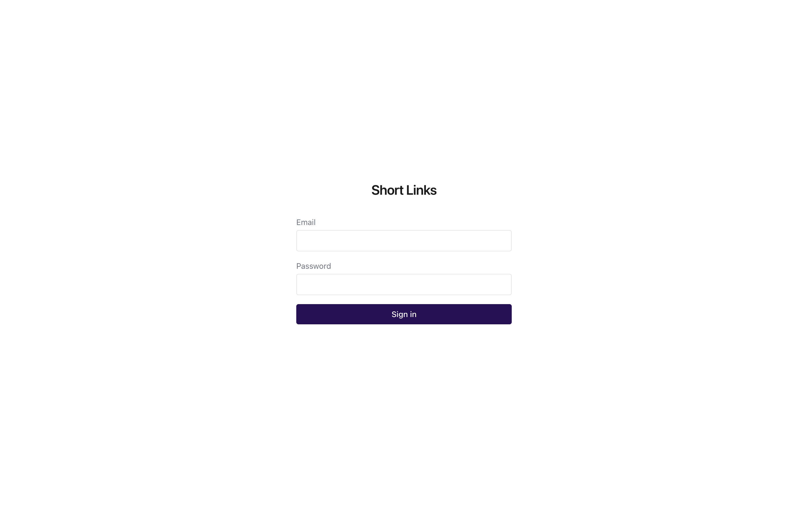
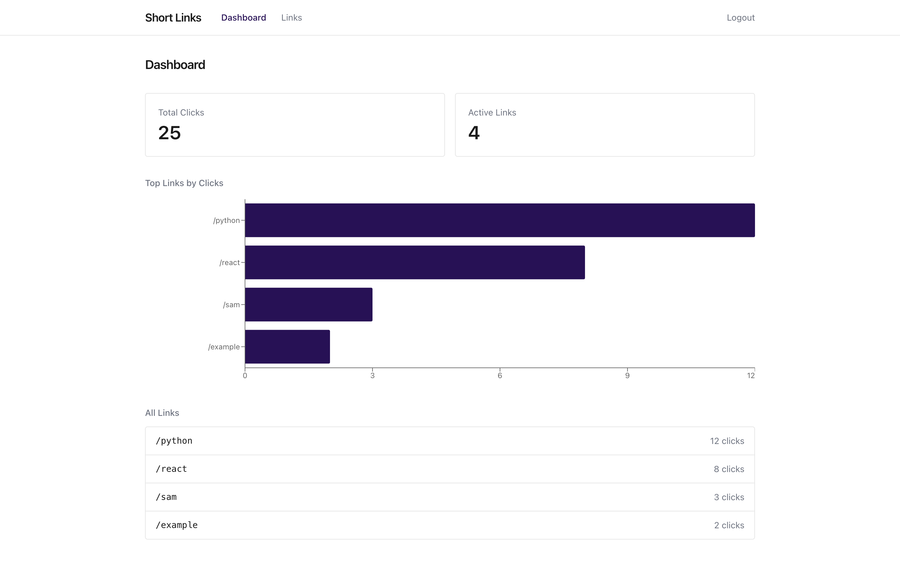
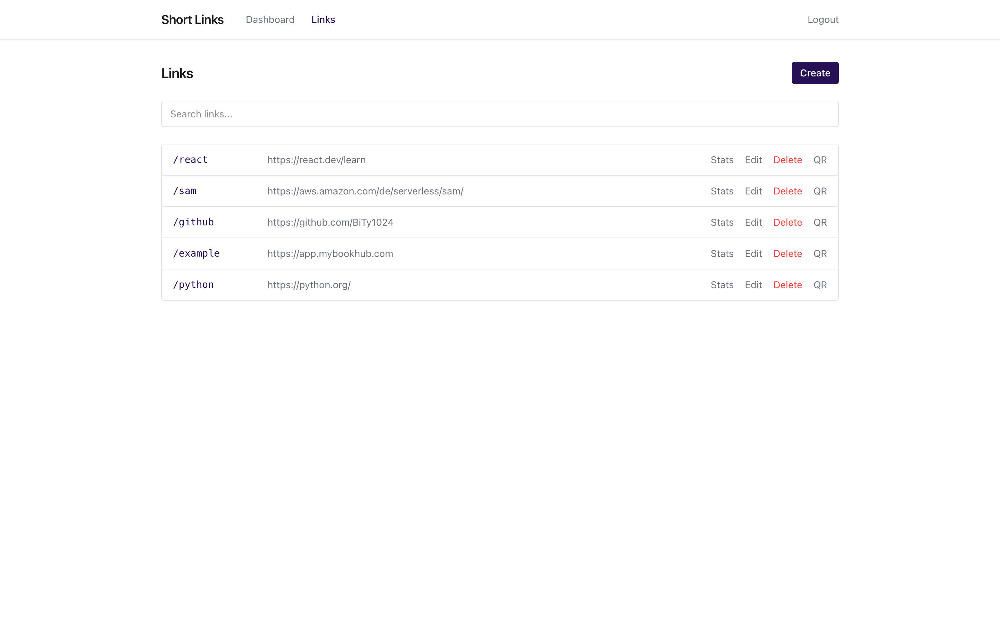

# Serverless Short Link Service

Serverless URL shortener with admin dashboard — create readable short links, control their targets, and track click analytics. Built with Go, React, and DynamoDB on AWS, deployed with **Terraform**.

**Live demo**: [admin.short.bookpass.de](https://admin.short.bookpass.de)
View-only login: `demo@short.bookpass.de` / `demo1234`

## Highlights

- **Terraform IaC** — the full stack ships as a modular Terraform configuration; the CloudFront cert (us-east-1) and the API cert (regional) are provisioned natively via provider aliasing and DNS validation.
- **Auth & roles** — Cognito JWT authorizer on the API, with `admin` (full CRUD) and `viewer` (read-only) groups.
- **Public redirects, protected admin** — redirect routes are open; every `/api/*` route is authenticated, CORS-locked to the admin origin, and rate-limited per route.
- **Private SPA hosting** — React dashboard served via CloudFront with Origin Access Control over a fully private S3 bucket.
- **Click analytics** — every redirect is recorded to DynamoDB (non-blocking, so tracking never breaks a redirect).
- **Go Lambdas** — one static arm64 binary per function on the `provided.al2023` runtime, with structured JSON logs via `log/slog`.


## Setup

The service runs under one **primary** domain: the management API and short
links at `<primary>`, the admin frontend at `admin.<primary>`. Any number of
**secondary** domains serve short links only; they are added later on the
settings page. Each domain gets its DNS records either by hand at an external
DNS host (`external`) or written to a Route 53 hosted zone (`route53`).

**Prerequisites**: AWS CLI, Terraform >= 1.11, Go (version in `lambdas/go.mod`), make, Python 3 (`deploy.sh` reads Terraform outputs with it), Node.js

```bash
# One-time: bootstrap the remote state backend (S3 bucket; locking uses S3 lock files)
cd terraform/bootstrap
terraform init && terraform apply -var "state_bucket_name=YOUR-UNIQUE-BUCKET"
# copy the printed backend_config_snippet into terraform/backend.hcl
cd ../..

cp terraform/envs/example.tfvars terraform/envs/myenv.tfvars  # fill in values
```

### Branding

Three optional variables brand the admin frontend. `deploy.sh` reads them from
the Terraform outputs and bakes them into the frontend build:

| Variable | Default | Effect |
|---|---|---|
| `accent_color` | `"#2A1058"` | Accent color (hex) of buttons, links and charts |
| `brand_name` | `"Short Links"` | Name in the header and on the login page, browser tab title, alt text of the logo |
| `brand_logo_url` | `""` | Logo in the header (28px high) and on the login page (48px high), also the favicon. Empty shows no logo |

The logo is loaded by the browser from that URL, so it must be publicly
reachable (for example a file on your website or a CDN).

### Primary domain with external DNS

With `primary_dns_mode = "external"` Terraform creates no DNS records. The
certificates cannot be validated before their validation records exist, so the
deployment runs in two phases.

1. **Phase 1: request the certificates.** This creates only the two
   certificates (regional for `<primary>`, us-east-1 for `admin.<primary>`) and
   returns at once:

   ```bash
   cd terraform
   terraform init -backend-config=backend.hcl
   terraform apply -var-file=envs/myenv.tfvars -target=module.certs
   terraform output certificate_validation_records
   ```

   Terraform warns that the plan is incomplete; that is expected with `-target`.

2. **Set the validation records** at the DNS host: one CNAME per entry, `name`
   to `value`. Keep them after deployment; ACM needs them to renew the
   certificates.

3. **Phase 2: deploy everything.** `deploy.sh` builds the Lambdas, runs a full
   `terraform apply` and publishes the frontend. The apply waits until ACM has
   validated both certificates (usually a few minutes after the records
   resolve; it gives up after 75 minutes), then creates the API custom domain,
   the CloudFront distribution and the rest.

   ```bash
   cd ..
   ./deploy.sh --config=terraform/envs/myenv.tfvars
   ```

4. **Point the domains at the service** with the records from
   `terraform output dns_records`:

   | Name | Type | Value |
   |---|---|---|
   | `<primary>` | CNAME | API Gateway regional domain (`d-….execute-api.<region>.amazonaws.com`) |
   | `admin.<primary>` | CNAME | CloudFront domain (`….cloudfront.net`) |

   The settings page shows the same records under the primary domain.

### Primary domain in Route 53

Set `primary_dns_mode = "route53"` and `primary_hosted_zone_id` to the hosted
zone that contains the primary domain. Terraform then writes the validation
records and the alias records itself, so a single
`./deploy.sh --config=terraform/envs/myenv.tfvars` does the whole deployment.

### Adding a secondary domain

On the admin frontend's **Domains** page (admins only; viewers see the list
read-only), add the domain with its DNS mode and fallback URL (where `/` and
unknown slugs redirect to). The service then:

1. requests a regional certificate and shows its **validation record**
   (`pending_validation`). In external mode, set it at the DNS host; in route53
   mode it is written to the chosen hosted zone;
2. once ACM has issued the certificate, creates the API Gateway custom domain
   and maps it to the API. In external mode the page shows the **CNAME** that
   points the domain at the API Gateway target (`pending_dns`); in route53 mode
   an alias record is written and the domain is active right away;
3. marks the domain `active` once public DNS resolves it to the target.

A scheduled check advances pending domains every five minutes; **Check now**
does it on demand. Links can be created on any configured domain and redirect
once it is active. A domain with links cannot be deleted; deleting one removes
its custom domain, the Route 53 records the service wrote, its certificate and
its setting.

Route 53 mode for secondary domains is off until the hosted zones are listed in
the Terraform variable `route53_zone_ids`; the domains Lambda may write records
only in those zones.

### Limits

- **No apex domains in external mode.** A zone apex (`example.com`) cannot be a
  CNAME. Use a subdomain (`go.example.com`), or a DNS host that flattens CNAMEs
  at the apex (ALIAS/ANAME); the check accepts a domain whose addresses match the
  target's. In route53 mode apex domains work through alias records.
- **Settings reach the redirect within 60 seconds.** The redirect caches the
  domain settings for 60 seconds, so a domain that just became active, a removed
  domain or a changed fallback URL takes up to a minute to apply. If the
  settings cannot be read and nothing is cached, every domain redirects to
  `default_redirect_url`.
- The primary domain's settings belong to Terraform: its fallback URL is
  `default_redirect_url`, and it cannot be deleted on the settings page.
- A certificate that ACM refuses (status `failed`, for example because of a CAA
  record) does not recover: delete the domain and add it again.
- The management API answers on every served domain, not only the primary:
  `https://<secondary>/api/...` reaches the same JWT-protected routes. Slugs
  cannot be `api`, so this never shadows a short link.
- The service never takes over what it did not create: an existing API Gateway
  custom domain mapped to another API, or a Route 53 record of the same name and
  type with another value, stops the setup with an error on the domain instead
  of being changed or deleted.

### Adding users

```bash
python3 add_user.py --user-pool-id "$(cd terraform && terraform output -raw user_pool_id)" \
  --email user@example.com --password '...' --group admin   # or viewer
```

## Development

The Lambdas live in `lambdas/`: one entry point per function in `cmd/<name>`, shared code in `internal/`.

```bash
cd lambdas
make test        # go test ./...
make vet         # go vet ./...
make fmt-check   # gofmt
make build       # linux/arm64 binaries in build/<name>/bootstrap
```

Terraform zips `lambdas/build/<name>/bootstrap`, so run `make build` before any full `terraform plan` or `apply` you run by hand.

Domain settings live in SSM Parameter Store, one String parameter per domain at
`/<stack_name>/domains/<domain>` holding JSON (role, DNS mode, status,
certificate, target and DNS records). Terraform writes the primary's; the
domains Lambda (`cmd/domains`) writes the secondaries'.

See [`terraform/README.md`](terraform/README.md) for the resource layout.

## API

All `/api/*` endpoints require `Authorization: Bearer <token>`. Redirects are public.

A link is addressed by domain and slug and served at `https://<domain>/<slug>`.
Links can only be created on domains that have a domain setting.
Slugs are unique per domain, so the same slug can exist on several domains. The
redirect Lambda takes the domain from the host the request was sent to.

| Method | Endpoint | Description |
|--------|----------|-------------|
| GET | `/api/links?domain=<d>` | List links of one domain, or of all domains without `domain` |
| POST | `/api/links` | Create link (admin); body `{"domain", "slug", "target_url"}` |
| PUT | `/api/links/{domain}/{slug}` | Update link target (admin); body `{"target_url"}` |
| DELETE | `/api/links/{domain}/{slug}` | Delete link (admin) |
| GET | `/api/stats?domain=<d>` | Click stats per link, for one domain or all domains |
| GET | `/api/stats/{domain}/{slug}` | Stats for one link |
| GET | `/api/domains` | Domain settings, the primary first, plus the hosted zones allowed for route53 mode |
| POST | `/api/domains` | Add a secondary domain (admin); body `{"domain", "dns_mode", "hosted_zone_id"?, "fallback_url"}` |
| POST | `/api/domains/{domain}/check` | Advance a pending domain now (admin) |
| PATCH | `/api/domains/{domain}` | Change the fallback URL of a secondary domain (admin); body `{"fallback_url"}` |
| DELETE | `/api/domains/{domain}` | Delete a secondary domain without links (admin); 409 with `link_count` otherwise |

Domains are lowercased and must be hostnames without scheme, port or path.
Stats support `?days=N`, `?from=YYYY-MM-DD&to=YYYY-MM-DD`, and (overview only)
`?linked_only=true`. The per-domain overview is a DynamoDB Query on the
`by-domain` index; the all-domains overview scans the whole stats table, so its
cost grows with the number of recorded clicks.

## Architecture

```
                        ┌──────────────────────────────────────────────┐
                        │           API Gateway (HTTP API)             │
                        │           short.bookpass.de                  │
                        └────┬──────────┬──────────┬───────────────────┘
                             ▼          ▼          ▼
                    ┌───────────┐ ┌──────────┐ ┌───────────┐
                    │ Redirect  │ │  Links   │ │   Stats   │
                    │  Lambda   │ │  Lambda  │ │  Lambda   │
                    │ (public)  │ │  (auth)  │ │  (auth)   │
                    └─────┬─────┘ └────┬─────┘ └─────┬─────┘
                          ▼            ▼             ▼
                    ┌──────────────────────────────────────┐
                    │             DynamoDB                 │
                    │    LinksTable  │  RedirectStatsTable │
                    └──────────────────────────────────────┘

  ┌─────────────────────┐              ┌───────────────────┐
  │   CloudFront + S3   │              │  Cognito (JWT)    │
  │ admin.HOSTEDZONE    │              │  roles            │
  │  React + Tailwind   │              └───────────────────┘
  └─────────────────────┘
```

## Screenshots

### Login

### Dashboard

### Link Management

### Link Stats
